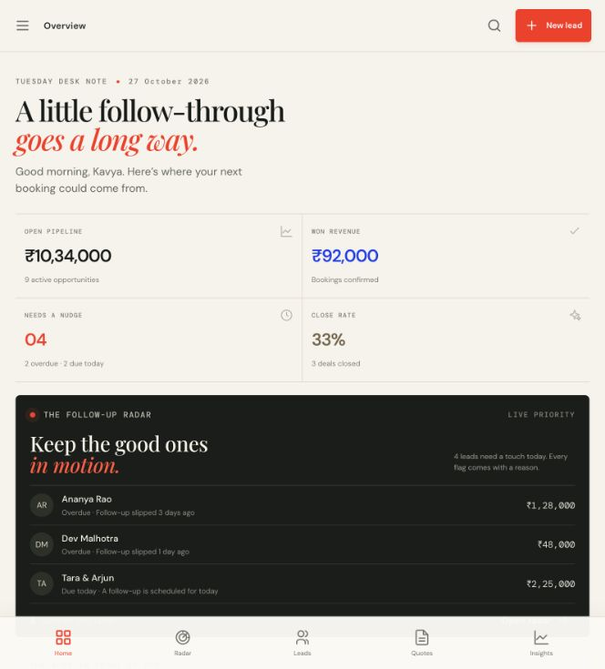

# LEADLOOP

An editorial revenue recovery desk for independent service businesses. LEADLOOP brings lead follow-ups, deal context, quotations, activity history, and simple revenue signals into one small workspace.



## Install on a laptop

LEADLOOP is a local web app, not a native `.dmg` or `.exe` installer. Install Node.js 20.19+ or 22.12+ (npm is included), then either download the project ZIP from GitHub and extract it, or clone the repository:

```sh
git clone https://github.com/karthikkumar6/leadloop.git
cd leadloop
npm install
npm run dev
```

Open the localhost address printed by Vite (usually `http://localhost:5173`). To stop the local server, press `Ctrl+C` in that terminal. The app saves its workspace in that browser’s local storage.

If you already cloned LEADLOOP, stop its running server with `Ctrl+C`, run `git pull origin main` from that clone, and then run `npm run dev` again. The browser page does not update just because GitHub changed.

For an instructor, share the GitHub repository for source review and a deployed Vercel URL for hands-on verification. The repository alone is not a hosted app. Never share a `localhost` link or put real client details in this public demo repository.

## Run locally

Requirements: Node.js 20.19+ or 22.12+ and npm.

```sh
npm install
npm run dev
```

Open the local URL printed by Vite. Setup lets you enter a business name and owner name. Choose **Use sample leads** to explore Studio June, or **Start empty** to create a workspace for your own business. INR is the default currency. Sample records are marked as demo data in the interface.

### Use your own business details and records

- To change the business name, owner name, or business category, open **Workspace settings**, edit the fields, and choose **Save workspace**. The owner name also updates the dashboard greeting and profile label.
- If you started with sample data, choose **Start with an empty workspace** in settings and confirm. LEADLOOP clears sample leads and quotations while keeping the business, owner, and category you entered. Then choose **New lead** and add your own records.
- **Reset demo data** restores the original Studio June sample business and sample records. Use **Start with an empty workspace** when you want a blank personal workspace.
- Workspace data is stored in the current browser’s local storage. It is separate for each browser and device, does not sync to Vercel or GitHub, and is not protected like an authenticated account. Use fictional or demo data in a public presentation.

## Production build

```sh
npm run build
npm run preview
```

The static site is written to `dist/`. No server environment variables or API keys are needed.

### Deploy on Vercel

**Git-connected deployment:** Sign in at [Vercel](https://vercel.com/), choose **Add New → Project**, and import `karthikkumar6/leadloop`. If the repository is missing, grant Vercel's GitHub app access to this repository in GitHub's app settings, then retry. Keep the Vite defaults or confirm **Build Command** `npm run build` and **Output Directory** `dist`, then choose **Deploy**. New commits on `main` can deploy automatically.

**Manual static deployment:** If you do not want to connect GitHub, run `npm run build`, choose **Add New → Project → Choose a folder to deploy** in Vercel, and select this project's `dist/` folder. Name the project and deploy it. This creates a public URL, but it is not linked to GitHub: after code changes, build again and upload the new `dist/` folder.

The hosted app is still a client-side demo: each viewer gets local browser data; records are not shared with the project owner or other viewers.

## What to submit to an instructor

Share these items in the assignment submission:

1. **Live demo:** the Vercel URL, once deployment succeeds.
2. **Source code:** [the public GitHub repository](https://github.com/karthikkumar6/leadloop).
3. **Short walkthrough:** show the dashboard, Follow-up Radar, a lead’s history, a draft WhatsApp message, quotation print/PDF, an outcome change, and the analytics. Use sample data or clearly label any fictional records.
4. **Setup note:** the README’s run instructions, plus the note that demo data stays in the browser and the prototype has no login or shared database.

Do not submit `localhost`, the local network IP, real customer data, API keys, or passwords.

## 90-second walkthrough

1. On setup, choose **Use sample leads** to see the labeled demo workspace, or **Start empty** to see your own blank workspace. The overview shows pipeline, won revenue, follow-ups, and close rate calculated from the current records.
2. Open **Follow-up radar**. Read the reason attached to an overdue, due-today, stale high-value, or upcoming lead. Open a lead, draft a WhatsApp note, or schedule a reminder.
3. In the message assistant, change purpose and tone, edit the copy, then copy it or open the encoded `wa.me` draft. LEADLOOP never sends automatically. Use “I sent it · log contact” only after sending outside the app.
4. Open **Leads**, filter or search, click a person, and review the context panel’s deal value and chronological history. Try a stage change or add a note.
5. Build a quotation from that lead, add an item and discount, save it, then use **Print / PDF** and the browser’s “Save as PDF” option.
6. Mark a lead won or lost and see the revenue, conversion, and lost-reason figures recompute from the current records. Refresh to confirm the browser save. In workspace settings, change the owner name, start with an empty workspace, or restore the sample data.

## Data and business logic

- `src/types.ts` defines leads, quotes, workspace settings, and activity records.
- `src/data.ts` supplies the resettable sample workspace.
- `src/store.ts` is the local persistence adapter. It is the intended seam for a hosted storage adapter.
- `src/logic.ts` centralizes currency formatting, date arithmetic, radar priority, quote totals, pipeline metrics, and trend grouping.
- `src/templates.ts` creates deterministic, editable WhatsApp drafts without a model or external service.

This prototype stores its current workspace in browser `localStorage`. It has no authentication, server backup, access controls, or multi-user collaboration. Treat browser data as non-secure and device-local. A production migration can add authenticated workspace identity and a hosted relational store behind the same application domain layer; enforce tenant ownership and authorization on the server, and keep the local adapter only for development or offline demos.

## Product and billing boundary

The settings view sketches Free, Pro, and Team plan architecture for future packaging. The tier chooser is only a local UI preview: there is no checkout, payment gateway, entitlement enforcement, or paid feature claim.
